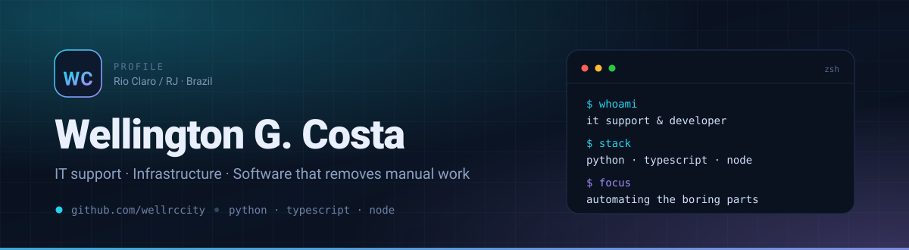

<picture>
  <source media="(prefers-color-scheme: dark)" srcset="./assets/hero-dark.svg">
  <source media="(prefers-color-scheme: light)" srcset="./assets/hero-light.svg">
  
</picture>

### Hey, I'm Wellington 👋

I work with **IT support, networks and infrastructure** at Rio Claro's city hall in Brazil, and I spend the rest of my time writing software that deletes repetitive work: Python CLIs, TypeScript web apps, internal dashboards and the occasional AI tooling experiment.

I got here the practical way — fixing machines, configuring networks and answering *"why isn't this working?"* long before shipping production code. That shapes how I build: small, documented and maintainable by whoever picks it up next.

- 🔭 **Building** browser automation for AI agents and a municipal services portal
- 🧩 **Into** clean APIs, zero-dependency tools and deterministic systems
- 🎯 **Open to** IT support / infrastructure and junior–mid development roles (hybrid or remote)
- 📍 Volta Redonda, RJ — Brazil

---

## 🚀 Featured projects

| Project | What it does | Stack |
| :--- | :--- | :--- |
| **[opencode-browser-bridge](https://github.com/wellrccity/opencode-browser-bridge)** | Chrome extension + local MCP server that lets an AI agent drive a real browser: navigate, click, type, read the DOM, capture screenshots — plus a ready-to-use skill. | `JavaScript` `MCP` `CDP` |
| **[portal-rio-claro-rj](https://github.com/wellrccity/portal-rio-claro-rj)** | Monorepo consolidating a NestJS backend and four web frontends for Rio Claro's institutional and administrative platform. | `TypeScript` `NestJS` |
| **[smart-file-organizer](https://github.com/wellrccity/smart-file-organizer)** | Zero-dependency CLI that sorts any folder into extension-based subfolders, with dry-run preview and verbose logging. | `Python` `CLI` |
| **[arbitrage-watcher](https://github.com/wellrccity/arbitrage-watcher)** | Cross-exchange price spread scanner built on CoinGecko's free API. Single file, standard library only. | `Python` `API` |
| **[Resonance_M](https://github.com/wellrccity/Resonance_M)** | Deterministic text generator indexed by the digits of π — same seed, same text, every time. | `Python` `Algorithms` |
| **[pokedex-html-js](https://github.com/wellrccity/pokedex-html-js)** | A Pokedex built with vanilla JS and the PokeAPI. My most starred repo. | `HTML` `CSS` `JavaScript` |

→ [See all repositories](https://github.com/wellrccity?tab=repositories)

## 🧰 Stack

**Languages**

**Frameworks & runtime**

**Tooling & environment**

## 📊 GitHub in numbers

<picture>
  <source media="(prefers-color-scheme: dark)" srcset="https://github-readme-stats.vercel.app/api?username=wellrccity&show_icons=true&hide_border=true&rank_icon=github&theme=tokyonight&include_all_commits=true">
  
</picture>
<picture>
  <source media="(prefers-color-scheme: dark)" srcset="https://github-readme-stats.vercel.app/api/top-langs/?username=wellrccity&layout=compact&hide_border=true&theme=tokyonight&langs_count=8">
  
</picture>

---

## 📬 Let's talk

Always up for talking about automation, infrastructure or a good debugging story.

